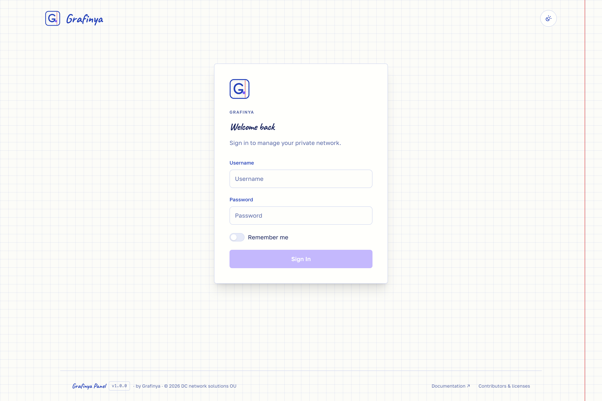
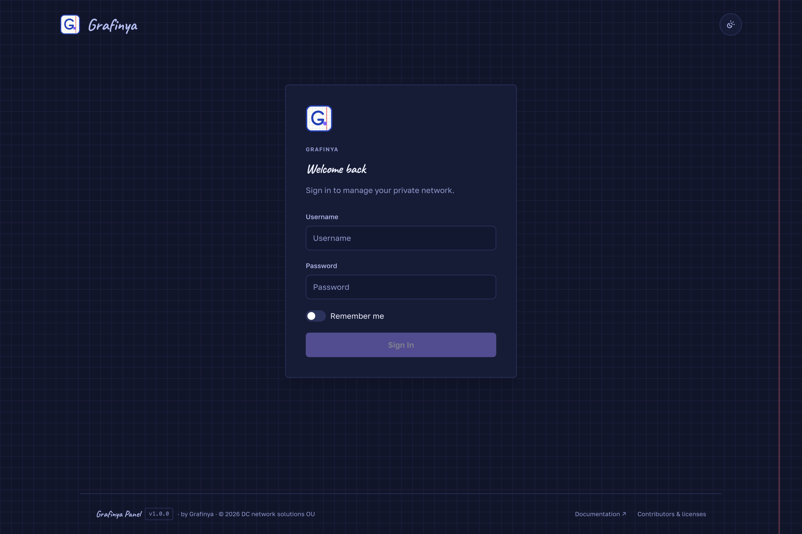
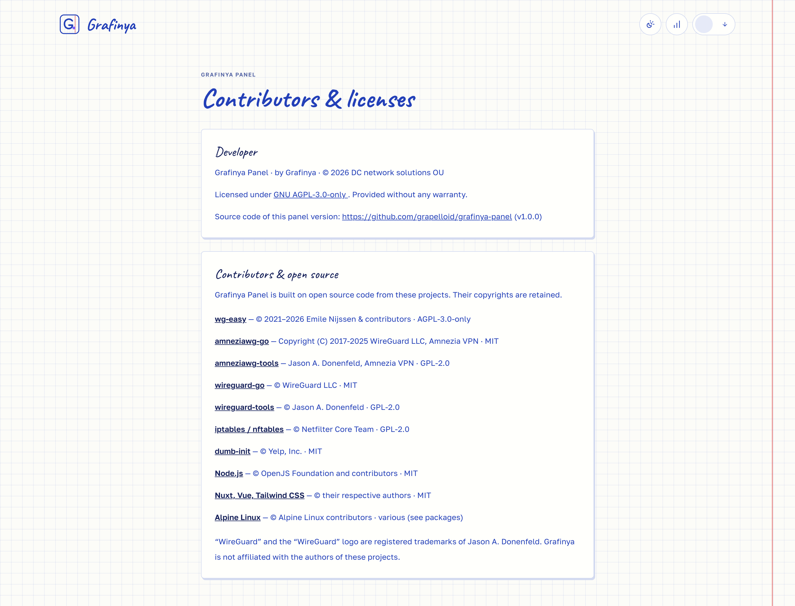

<div align="center">


# Grafinya Panel

**Your own secure network on your own server — in one command.**<br/>
A management panel and Grafinya VPN node in a single container. No clouds, no middlemen, no plans.

[](CHANGELOG.md)
[](LICENSE)
[](#-quick-start)

[Quick start](#-quick-start) ·
[Features](#-features) ·
[Documentation](#-documentation) ·
[Security](#-security) ·
[Authors](#-authors)

<br/>

<picture>
  <source media="(prefers-color-scheme: dark)" srcset="assets/clients-dark.png">
  
</picture>

</div>

---

## ✦ What it is

**Grafinya Panel** is a self-hosted panel for your own secure Grafinya tunnel.
Take a server, run one command, and you get a web panel where you create connections
for your devices: laptop, phone, tablet, router. Each connection is a `.conf` file with
the keys and tunnel parameters.

- 🔒 **Your server, your data.** The panel and the VPN node run on your machine: no
  external accounts, no analytics.
- 🫥 **Traffic doesn't look like a VPN.** Grafinya obfuscation is on by default, which
  makes the connection harder to detect and block.
- ⚡ **Zero configuration.** The wizard only asks for an admin username and password —
  the panel detects the server address and port by itself.

## ✦ Features

<table>
<tr>
<td width="50%" valign="top">

**Connections**
- create, edit, disable, delete
- `.conf` file, QR code and one-time link
- expiration date, extended by changing the date
- search, filters, bulk actions

</td>
<td width="50%" valign="top">

**Server**
- panel + VPN node in one Docker container
- Grafinya obfuscation (Jc, Jmin/Jmax, S1–S4, H1–H4, I1–I5)
- IPv4 and IPv6, client-to-client firewall
- traffic charts, Prometheus / JSON metrics

</td>
</tr>
<tr>
<td valign="top">

**Security**
- password sign-in and two-factor authentication (TOTP)
- OAuth / OIDC sign-in
- secure sessions and CSRF protection
- open source

</td>
<td valign="top">

**Convenience**
- "graph paper notebook" design, light and dark themes
- runs on a small VPS
- one-command updates

</td>
</tr>
</table>

## ✦ Screenshots

<table>
<tr>
<td width="50%"></td>
<td width="50%"></td>
</tr>
<tr>
<td align="center"><sub>Sign in · light theme</sub></td>
<td align="center"><sub>Sign in · dark theme</sub></td>
</tr>
<tr>
<td></td>
<td></td>
</tr>
<tr>
<td align="center"><sub>Network interface and obfuscation</sub></td>
<td align="center"><sub>Contributors &amp; licenses</sub></td>
</tr>
</table>

## ✦ Quick start

You need a Linux server (Ubuntu, Debian, etc.) with a public IPv4 address and root access.

```bash
# 1. Docker
curl -sSL https://get.docker.com | sh

# 2. Panel
git clone https://github.com/grapelloid/grafinya-panel.git
cd grafinya-panel

# 3. Start (the first build takes a few minutes: it compiles the Grafinya VPN core)
docker compose up -d
```

Open `https://<domain-or-IP>:51821` and create the administrator — that's the only step.
The panel detects the server address by itself (public IPv4 via `api.ipify.org` /
`ifconfig.me` / `icanhazip.com`, otherwise the address you opened it at); the VPN port is
`51820/udp`. Next: "New client" → download the `.conf` → import it into the app.

> [!IMPORTANT]
> By default the panel expects HTTPS. Put a [reverse proxy](#domain-and-https) in front of it.
> To sign in temporarily over `http://IP:51821`, uncomment the `environment:` block in
> `docker-compose.yml`, set `INSECURE=true` and run `docker compose up -d` — for testing only.

## ✦ Documentation

<details open>
<summary><b>Ports</b></summary>

<br/>

| Port        | Purpose                              |
| ----------- | ------------------------------------ |
| `51820/udp` | secure Grafinya tunnel               |
| `51821/tcp` | web panel (best kept behind a proxy) |

Open them in the server firewall (`ufw allow 51820/udp && ufw allow 51821/tcp`)
and in your cloud provider's security settings.

</details>

<details>
<summary><b>Environment variables</b></summary>

<br/>

Set them in `docker-compose.yml`, in the `environment:` block.

| Variable                | Default         | What it does |
| ----------------------- | --------------- | ------------ |
| `PORT`                  | `51821`         | web panel port |
| `INSECURE`              | `false`         | allow sign-in over HTTP without TLS (testing only) |
| `PUBLIC_HOST`           | auto            | domain or IP for clients instead of auto-detection (applied on first setup) |
| `VPN_PORT`              | `51820`         | VPN port; change it together with `ports:` |
| `OVERRIDE_AUTO_AWG`     | —               | `wg` disables obfuscation (plain tunnel mode) |
| `DISABLE_IPV6`          | `false`         | disable IPv6 |
| `DISABLE_VERSION_CHECK` | `false`         | don't check GitHub for updates |
| `TRUSTED_PROXIES`       | —               | reverse proxy addresses (IP/CIDR) whose `X-Forwarded-*` headers are trusted |
| `DOCS_URL`              | this README     | "Documentation" link in the panel footer |
| `SOURCE_URL`            | this repository | source code link on the licenses page |

`HOST` is the address the panel listens on inside the container (`0.0.0.0`), not the
server's public IP: use `PUBLIC_HOST` for the public address.

</details>

<details>
<summary><b>Domain and HTTPS</b></summary>

<br/>

Point a domain's A record at the server IP and put a reverse proxy (Caddy, Traefik, nginx)
in front of the panel. Example with [Caddy](https://caddyserver.com), which obtains the
certificate automatically:

```caddyfile
panel.example.com {
    reverse_proxy 127.0.0.1:51821
}
```

Then close port `51821` to the outside (publish it as `127.0.0.1:51821:51821/tcp`) — only
`51820/udp`, `80` and `443` remain open.

</details>

<details>
<summary><b>Connections and .conf files</b></summary>

<br/>

1. "New client" → a name (for example, "Anna's phone") and, if needed, an expiration date.
2. On the client card: download the `.conf`, show the QR code or create a one-time link.
3. Transfer the file to the device (AirDrop, Files, e-mail) and import it into the app.

To extend access, change the expiration date. To pause it, use the toggle on the card.
The address and port can be changed in the admin area ("Configuration" and "Interface").

</details>

<details>
<summary><b>Update, backup, restore</b></summary>

<br/>

The database and keys live in the `grafinya-panel_grafinya_data` Docker volume and survive rebuilds.

```bash
# update
git pull
docker compose up -d --build

# backup
docker run --rm -v grafinya-panel_grafinya_data:/data -v "$PWD":/backup alpine \
  tar czf /backup/grafinya-backup.tgz -C /data .

# restore
docker compose down
docker run --rm -v grafinya-panel_grafinya_data:/data -v "$PWD":/backup alpine \
  sh -c "rm -rf /data/* && tar xzf /backup/grafinya-backup.tgz -C /data"
docker compose up -d
```

</details>

<details>
<summary><b>Troubleshooting</b></summary>

<br/>

| Symptom | What to check |
| ------- | ------------- |
| The panel doesn't open | `docker ps` — is the `grafinya` container running? Is port `51821` open in the firewall and at the provider? |
| Can't sign in over `http://` | use HTTPS or temporarily set `INSECURE=true` |
| Connected, but websites don't load | is `51820/udp` open? Does `Endpoint` in the `.conf` match the server address? |
| Container is `unhealthy` | `docker logs grafinya` — tunnel startup errors |
| Forgot the admin password | `docker exec -it grafinya cli db:admin:reset` |

</details>

## ✦ Security

- Use HTTPS, a strong password and two-factor authentication.
- Keep the web port `51821` behind a reverse proxy; expose only `51820/udp`.
- Update regularly: `git pull && docker compose up -d --build`.
- Found a vulnerability? Open an [issue](https://github.com/grapelloid/grafinya-panel/issues)
  labelled **security** without exploitation details, and we'll get in touch.

## ✦ Development

```bash
cd src
pnpm install
pnpm dev                                      # dev server
pnpm lint && pnpm typecheck && pnpm test:unit # checks before committing
```

How to propose changes: [contributing.md](contributing.md). Version history: [CHANGELOG.md](CHANGELOG.md).

## ✦ Authors

<div align="center">

**Grafinya Panel — by Grafinya**<br/>
© 2026 DC network solutions OU

</div>

<details>
<summary><b>Contributors &amp; licenses</b></summary>

<br/>

Grafinya Panel is built on the open-source code of these projects; their copyrights are preserved.

- [wg-easy](https://github.com/wg-easy/wg-easy) — © 2021–2026 Emile Nijssen & contributors · AGPL-3.0-only
- [amneziawg-go](https://github.com/amnezia-vpn/amneziawg-go) — © 2017–2025 WireGuard LLC, Amnezia VPN · MIT
- [amneziawg-tools](https://github.com/amnezia-vpn/amneziawg-tools) — Jason A. Donenfeld, Amnezia VPN · GPL-2.0
- wireguard-go — © WireGuard LLC · MIT; wireguard-tools — © Jason A. Donenfeld · GPL-2.0
- iptables / nftables · GPL-2.0
- Node.js, Nuxt, Vue — © their authors · MIT

Inside the panel this list opens from the "Contributors & licenses" link in the footer.

"WireGuard" and the "WireGuard" logo are registered trademarks of Jason A. Donenfeld.
Grafinya is an independent project and is not affiliated with the authors of the projects above.

</details>

## ✦ License

[GNU AGPL-3.0-only](LICENSE). Grafinya Panel is based on [wg-easy](https://github.com/wg-easy/wg-easy)
(AGPL-3.0); Grafinya's changes are distributed under the same terms. If you run a modified
version as a service, the AGPL requires you to offer its source code to users — the link
is already on the "Contributors & licenses" page.
