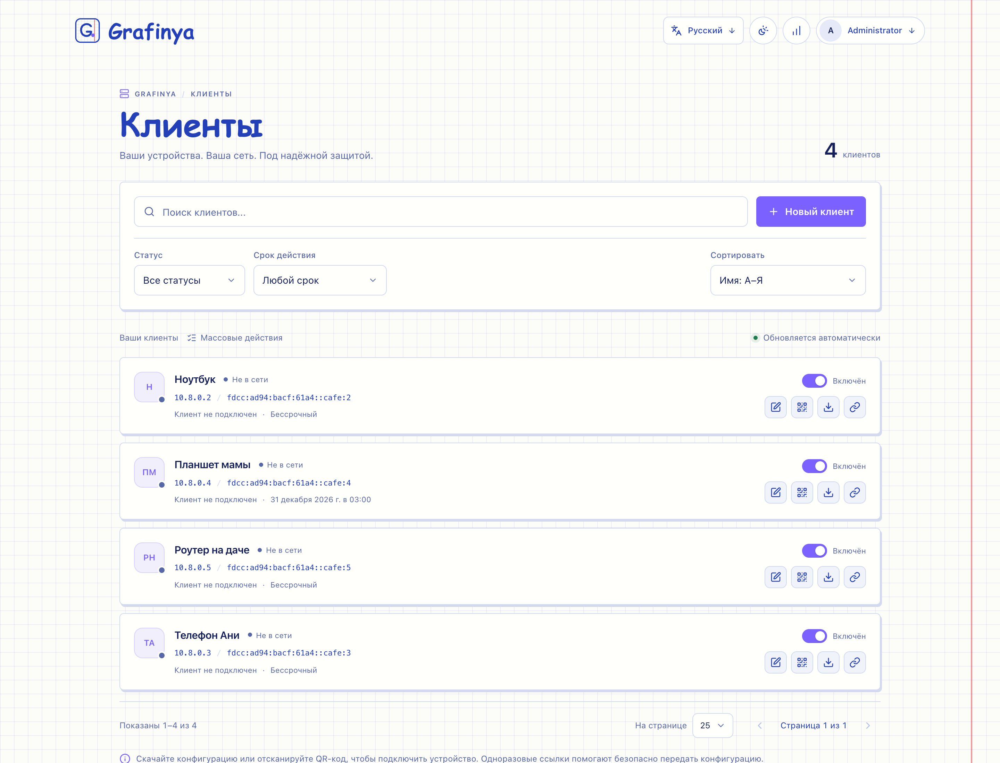
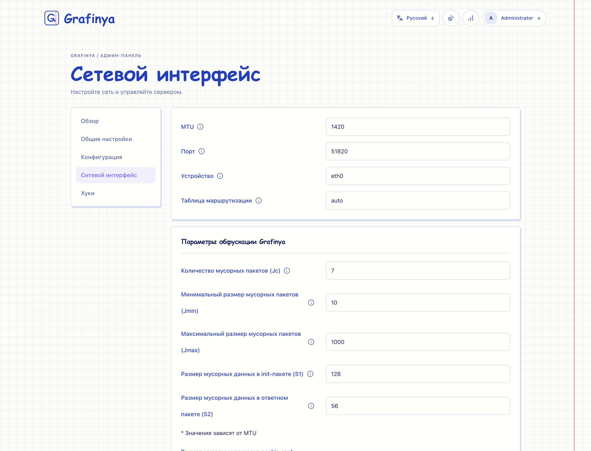

<div align="center">


# Grafinya Panel

**Своя защищённая сеть на своём сервере — за одну команду.**<br/>
Панель управления и VPN-нода Grafinya в одном контейнере. Без облаков, без посредников, без тарифов.

[](CHANGELOG.md)
[](LICENSE)
[](#-быстрый-старт)

[Быстрый старт](#-быстрый-старт) ·
[Возможности](#-возможности) ·
[Документация](#-документация) ·
[Безопасность](#-безопасность) ·
[Авторы](#-авторы)

<br/>

<picture>
  <source media="(prefers-color-scheme: dark)" srcset="assets/clients-dark.png">
  
</picture>

</div>

---

## ✦ Что это

**Grafinya Panel** — self-host панель для собственного защищённого туннеля Grafinya.
Берёте сервер, запускаете одну команду — и получаете веб-панель, в которой создаёте
подключения для своих устройств: ноутбука, телефона, планшета, роутера. Каждое
подключение — это файл `.conf` с ключами и параметрами туннеля.

- 🔒 **Ваш сервер — ваши данные.** Панель и VPN-нода работают у вас: никаких внешних
  аккаунтов и аналитики.
- 🫥 **Трафик не похож на VPN.** Обфускация Grafinya включена по умолчанию —
  соединение сложнее распознать и заблокировать.
- ⚡ **Ноль настройки.** Мастер спрашивает только логин и пароль администратора — адрес
  сервера и порт панель определяет сама.

## ✦ Возможности

<table>
<tr>
<td width="50%" valign="top">

**Подключения**
- создание, редактирование, отключение, удаление
- файл `.conf`, QR-код и одноразовая ссылка
- срок действия и продление сменой даты
- поиск, фильтры, массовые действия

</td>
<td width="50%" valign="top">

**Сервер**
- панель + VPN-нода в одном Docker-контейнере
- обфускация Grafinya (Jc, Jmin/Jmax, S1–S4, H1–H4, I1–I5)
- IPv4 и IPv6, межклиентский firewall
- графики трафика, метрики Prometheus / JSON

</td>
</tr>
<tr>
<td valign="top">

**Безопасность**
- вход по паролю и двухфакторная аутентификация (TOTP)
- вход через OAuth / OIDC
- защищённые сессии и защита от CSRF
- открытый исходный код

</td>
<td valign="top">

**Удобство**
- оформление «тетрадь в клетку», светлая и тёмная тема
- интерфейс на русском и других языках
- работает на небольшом VPS
- обновление одной командой

</td>
</tr>
</table>

## ✦ Скриншоты

<table>
<tr>
<td width="50%"></td>
<td width="50%"></td>
</tr>
<tr>
<td align="center"><sub>Вход · светлая тема</sub></td>
<td align="center"><sub>Вход · тёмная тема</sub></td>
</tr>
<tr>
<td></td>
<td></td>
</tr>
<tr>
<td align="center"><sub>Сетевой интерфейс и обфускация</sub></td>
<td align="center"><sub>Участники и лицензии</sub></td>
</tr>
</table>

## ✦ Быстрый старт

Нужен Linux-сервер (Ubuntu, Debian и т. п.) с публичным IPv4 и root-доступом.

```bash
# 1. Docker
curl -sSL https://get.docker.com | sh

# 2. Панель
git clone https://github.com/grapelloid/grafinya-panel.git
cd grafinya-panel

# 3. Запуск (первая сборка — несколько минут: собирается VPN-ядро Grafinya)
docker compose up -d
```

Откройте `https://<домен-или-IP>:51821` и создайте администратора — это единственный шаг.
Адрес сервера панель определит сама (публичный IPv4 через `api.ipify.org` / `ifconfig.me` /
`icanhazip.com`, иначе — адрес, по которому вы её открыли), VPN-порт — `51820/udp`.
Дальше: «Новый клиент» → скачать `.conf` → открыть в приложении.

> [!IMPORTANT]
> Панель по умолчанию ждёт HTTPS. Поставьте перед ней [reverse proxy](#домен-и-https).
> Чтобы временно зайти по `http://IP:51821`, раскомментируйте в `docker-compose.yml`
> блок `environment:`, выставьте `INSECURE=true` и выполните `docker compose up -d` —
> только для теста.

## ✦ Документация

<details open>
<summary><b>Порты</b></summary>

<br/>

| Порт        | Назначение                            |
| ----------- | ------------------------------------- |
| `51820/udp` | защищённый туннель Grafinya           |
| `51821/tcp` | веб-панель (лучше спрятать за прокси) |

Откройте их в firewall сервера (`ufw allow 51820/udp && ufw allow 51821/tcp`)
и в панели облачного провайдера.

</details>

<details>
<summary><b>Переменные окружения</b></summary>

<br/>

Задаются в `docker-compose.yml`, блок `environment:`.

| Переменная              | По умолчанию     | Что делает |
| ----------------------- | ---------------- | ---------- |
| `PORT`                  | `51821`          | порт веб-панели |
| `INSECURE`              | `false`          | разрешить вход по HTTP без TLS (только для теста) |
| `PUBLIC_HOST`           | авто             | домен или IP для клиентов вместо автоопределения |
| `VPN_PORT`              | `51820`          | VPN-порт; меняйте вместе с портом в `ports:` |
| `OVERRIDE_AUTO_AWG`     | —                | `wg` — выключить обфускацию (режим без маскировки) |
| `DISABLE_IPV6`          | `false`          | отключить IPv6 |
| `DISABLE_VERSION_CHECK` | `false`          | не проверять обновления на GitHub |
| `DOCS_URL`              | этот README      | ссылка «Документация» в футере панели |
| `SOURCE_URL`            | этот репозиторий | ссылка на исходный код на странице лицензий |

`HOST` — это адрес, на котором панель слушает внутри контейнера (`0.0.0.0`), а не
публичный IP сервера: для публичного адреса используйте `PUBLIC_HOST`.

</details>

<details>
<summary><b>Домен и HTTPS</b></summary>

<br/>

Направьте A-запись домена на IP сервера и поставьте перед панелью reverse proxy
(Caddy, Traefik, nginx). Пример с [Caddy](https://caddyserver.com) — сертификат он получит сам:

```caddyfile
vpn.example.com {
    reverse_proxy 127.0.0.1:51821
}
```

После этого закройте порт `51821` снаружи — останутся `51820/udp`, `80` и `443`.

</details>

<details>
<summary><b>Подключения и файлы .conf</b></summary>

<br/>

1. «Новый клиент» → имя (например, «Телефон Ани») и, если нужно, срок действия.
2. На карточке клиента — скачать `.conf`, показать QR-код или создать одноразовую ссылку.
3. Передайте файл на устройство (AirDrop, «Файлы», почта) и добавьте его в приложении.

Продлить доступ — сменить дату окончания. Приостановить — переключатель на карточке.
Адрес и порт можно поменять в админке («Конфигурация» и «Сетевой интерфейс»).

</details>

<details>
<summary><b>Обновление, резервная копия, восстановление</b></summary>

<br/>

База и ключи лежат в Docker-томе `grafinya-panel_grafinya_data` и переживают пересборку.

```bash
# обновление
git pull
docker compose up -d --build

# резервная копия
docker run --rm -v grafinya-panel_grafinya_data:/data -v "$PWD":/backup alpine \
  tar czf /backup/grafinya-backup.tgz -C /data .

# восстановление
docker compose down
docker run --rm -v grafinya-panel_grafinya_data:/data -v "$PWD":/backup alpine \
  sh -c "rm -rf /data/* && tar xzf /backup/grafinya-backup.tgz -C /data"
docker compose up -d
```

</details>

<details>
<summary><b>Решение проблем</b></summary>

<br/>

| Симптом | Что проверить |
| ------- | ------------- |
| Панель не открывается | `docker ps` — контейнер `grafinya` запущен? Порт `51821` открыт в firewall и у провайдера? |
| Не пускает войти по `http://` | откройте по HTTPS или временно включите `INSECURE=true` |
| Подключение есть, а сайты не грузятся | открыт ли `51820/udp`? совпадает ли `Endpoint` в `.conf` с адресом сервера? |
| Контейнер `unhealthy` | `docker logs grafinya` — ошибки запуска туннеля |
| Забыли пароль администратора | `docker exec -it grafinya cli db:admin:reset` |

</details>

## ✦ Безопасность

- Включите HTTPS, придумайте сложный пароль и включите двухфакторную аутентификацию.
- Спрячьте веб-порт `51821` за reverse proxy, наружу оставьте `51820/udp`.
- Регулярно обновляйтесь: `git pull && docker compose up -d --build`.
- Нашли уязвимость? Откройте [issue](https://github.com/grapelloid/grafinya-panel/issues)
  с пометкой **security** без деталей эксплуатации — мы свяжемся с вами.

## ✦ Разработка

```bash
cd src
pnpm install
pnpm dev                                      # dev-сервер
pnpm lint && pnpm typecheck && pnpm test:unit # проверки перед коммитом
```

Как предложить изменения — в [contributing.md](contributing.md). История версий — в [CHANGELOG.md](CHANGELOG.md).

## ✦ Авторы

<div align="center">

**Grafinya Panel — by Grafinya**<br/>
© 2026 DC network solutions OU

</div>

<details>
<summary><b>Участники и лицензии</b></summary>

<br/>

Grafinya Panel построена на открытом коде этих проектов; их авторские права сохранены.

- [wg-easy](https://github.com/wg-easy/wg-easy) — © 2021–2026 Emile Nijssen & contributors · AGPL-3.0-only
- [amneziawg-go](https://github.com/amnezia-vpn/amneziawg-go) — © 2017–2025 WireGuard LLC, Amnezia VPN · MIT
- [amneziawg-tools](https://github.com/amnezia-vpn/amneziawg-tools) — Jason A. Donenfeld, Amnezia VPN · GPL-2.0
- wireguard-go — © WireGuard LLC · MIT; wireguard-tools — © Jason A. Donenfeld · GPL-2.0
- iptables / nftables · GPL-2.0
- Node.js, Nuxt, Vue — © их авторы · MIT

В самой панели этот список открывается по ссылке «Участники и лицензии» в футере.

"WireGuard" and the "WireGuard" logo are registered trademarks of Jason A. Donenfeld.
Grafinya — независимый проект и не связан с авторами перечисленных проектов.

</details>

## ✦ Лицензия

[GNU AGPL-3.0-only](LICENSE). Grafinya Panel основана на [wg-easy](https://github.com/wg-easy/wg-easy)
(AGPL-3.0); изменения Grafinya распространяются на тех же условиях. Если вы запускаете
изменённую версию как сервис, AGPL требует дать пользователям её исходный код — ссылка
на него уже есть на странице «Участники и лицензии».
